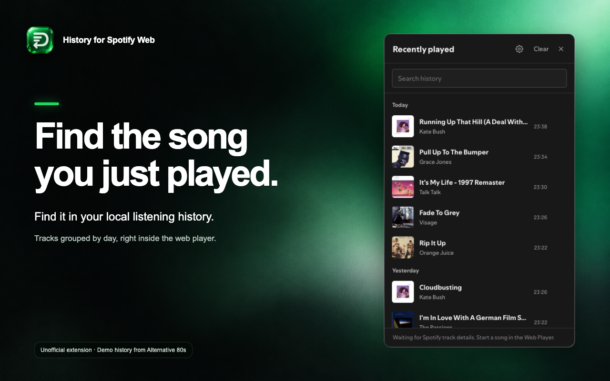

# History for Spotify Web

[English](README.md) · [Português (Brasil)](README.pt-BR.md) · [Español](README.es.md)

Te saltaste una canción buenísima. Ahora no recuerdas cómo se llamaba.

History for Spotify Web añade un historial de canciones con búsqueda al reproductor web de Spotify. Ábrelo desde el reloj junto a los controles de reproducción o desde el icono de la extensión. En las opciones del historial puedes elegir **Barra de reproducción**, **Botón flotante** (solo icono) o **Barra superior**. Las dos vistas comparten el mismo historial.

## Instalar

[Disponible en Chrome Web Store](https://chromewebstore.google.com/detail/mankfcbajkkgnahooffhiookcbbicohn).

Instala la extensión y recarga la pestaña o PWA de Spotify. Puedes quitar el icono de la barra del navegador: el botón **Historial** seguirá dentro de Spotify. Mantén una pestaña de Spotify abierta para usar la ventana de la extensión.

La interfaz sigue el idioma del navegador: español, portugués de Brasil o inglés. Para otros idiomas, usa el inglés.

## Qué hace

- Guarda la canción que dejas atrás cuando Spotify cambia de pista, incluidos los saltos.
- Permite buscar por título o artista y guardar 50, 200 o 500 entradas, agrupadas por día.
- Añade un menú por canción para ponerla en la cola, copiar su enlace o eliminarla del historial.
- Exporta e importa copias en JSON, sin duplicar los registros que ya existen.
- Añade botones Atrás y Adelante. Puedes arrastrar la cabecera del historial para mover el panel.

## Instalar desde GitHub

1. [Descarga el código en ZIP](https://github.com/demetriusk/history-for-spotify-web/archive/refs/heads/main.zip) y descomprímelo en una carpeta que vayas a conservar.
2. Abre `chrome://extensions` o `vivaldi://extensions` y activa el modo de desarrollador.
3. Pulsa **Cargar descomprimida** y selecciona la carpeta `extension`, que contiene `manifest.json`.
4. Si usas el script de Tampermonkey, desactívalo. Recarga Spotify con **Ctrl+R** o **⌘R** en Mac.
5. Reproduce una canción y pasa a otra. Abre **Historial** para ver la que acabas de dejar.

Conserva la carpeta: el navegador carga la extensión desde ahí. Las instalaciones locales no reciben actualizaciones automáticas de la tienda. Para actualizar, sustituye los archivos, recarga la extensión y después Spotify. Desactiva la copia local antes de instalar la versión de la tienda.

## Qué conviene saber

El historial empieza al instalar la extensión y observa los cambios de canción mientras Spotify Web está abierto. No recupera sesiones anteriores ni escuchas de otras aplicaciones o navegadores. Funciona en Chrome y en navegadores Chromium compatibles con extensiones, como Vivaldi; requiere Chromium 114 o posterior.

Al elegir **Añadir a la cola**, la extensión busca la canción exacta y usa el menú de Spotify. Reconoce los menús en inglés, español y portugués de Brasil. Añade la canción a la cola manual y vuelve a la pantalla anterior. Spotify decide si esa acción está disponible para tu cuenta y dispositivo. La extensión no añade llamadas a API exclusivas de Premium.

Si no se conoce el enlace exacto de una canción, puedes buscarla o eliminarla del historial, pero no copiar su enlace ni añadirla a la cola desde el menú. Los cambios en la interfaz de Spotify pueden afectar a estas funciones.

## Tus datos

El historial, su límite y la posición del botón se guardan en los datos locales de `open.spotify.com` de este navegador. La extensión no tiene servidor, analíticas ni sincronización. Los scripts de la página de Spotify pueden acceder a ese mismo almacenamiento.

**Borrar** elimina el historial guardado; **Eliminar** quita una entrada. Borrar los datos del sitio de Spotify también borra el historial. Desinstalar la extensión puede dejar esos datos en el navegador: bórralos antes si quieres eliminarlos.

[Privacidad](PRIVACY.md), [instrucciones de desarrollo](README.md#build-and-test) y [soporte](https://github.com/demetriusk/history-for-spotify-web/issues). La política de privacidad y las instrucciones de desarrollo están en inglés.

Código abierto con licencia [MIT](LICENSE). Extensión independiente y no oficial, sin afiliación ni respaldo de Spotify.
