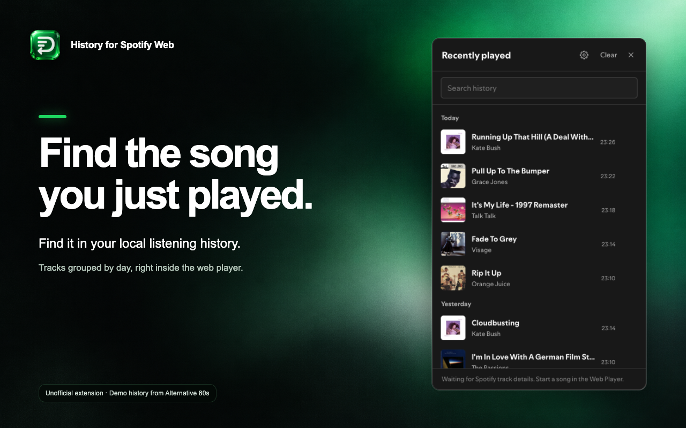

# History for Spotify Web

Find the song that played three tracks ago.

History for Spotify Web adds a searchable listening history to Spotify's web player. Open **History** in the top bar to find a track, copy its link, or add it back to the queue through Spotify's own controls.



## What it does

- Records the track you leave when Spotify changes songs, while the web player is open.
- Keeps 50, 200, or 500 entries, grouped by day and searchable by title or artist.
- Puts Queue, Copy link, and Remove in each track's menu.
- Exports and imports history as JSON, skipping duplicate records on import.
- Adds Back and Forward buttons beside the Spotify logo. Drag the history panel by its header to move it.

## Why use the web player?

If most of your day is already in a browser, Spotify can stay there too. Use a tab or an app-style browser window without installing another music client. You keep Spotify's own interface and sign in directly with Spotify.

This extension adds a way back to tracks you've played. It doesn't replace Spotify's player, fetch audio, or ask for a separate Spotify developer account.

We haven't benchmarked startup time, memory use, or playback performance against the desktop app or unofficial clients. Choose the player that works best on your setup. History for Spotify Web is for people who prefer the browser.

## Install locally

Chrome Web Store publication is pending. To try the unpacked extension:

1. Run `python3 scripts/build.py` from this folder.
2. Open `chrome://extensions`, enable Developer mode, and choose **Load unpacked**.
3. Select the `extension` folder, then reload `https://open.spotify.com/`.
4. Disable the matching Tampermonkey script if you previously installed it.

The extension uses Manifest V3 and requires Chromium 114 or later. Chrome is the store target. Chromium browsers that support Chrome extensions, including Vivaldi, can load the same package; browser-specific PWA behaviour may vary. Browser extensions don't add features to Spotify's desktop or mobile apps.

## What to expect

History starts when you install the extension. It records changes it observes in the open web player; it can't recover older listening sessions or activity from another browser or the desktop app. Skipped songs can appear too. This is a local record of track changes, not proof that you listened to a full song.

Queue uses Spotify search and the matching track's native **Add to queue** control. A loading state covers the search while it runs, then returns you to the previous screen. The track goes into **Next in queue**. Moving it into **Next up** depends on Spotify; that cross-section drag has removed tracks in the tested player. The extension doesn't change that behaviour.

Queue relies on the English “Add to queue” menu label. Other Spotify interface languages are not yet supported for that action. When an exact track ID isn't available, a history entry can still open search and be removed; Queue and Copy link are unavailable for that entry. Spotify UI changes can break selectors.

The extension adds no Premium-only API calls. Spotify decides which playback and queue controls are available to your account and active device.

## Your history

History and the selected limit stay in your browser's `open.spotify.com` site storage. There is no extension server, analytics, or browser sync. Spotify's page scripts can access that same site storage. Browser profiles and different browsers keep separate records.

Changing to a smaller limit asks before deleting older entries. Export a backup first if you want to keep them. Import merges valid records, sorts the result by time, and keeps the newest records up to the selected limit.

**Clear** deletes the saved history in this browser. **Remove** deletes one play. Clearing Spotify's site data also removes it. Uninstalling the extension alone may leave site storage behind; clear your history before uninstalling if you want to delete it.

Read the [privacy policy](PRIVACY.md) for the fields stored and the network requests involved.

## Build and test

The extension has no runtime dependencies. Building requires Python 3; syntax checks and browser tests use Node.js. Playwright is a development dependency.

```sh
python3 scripts/build.py
python3 scripts/check.py
node --check extension/history.js
```

To publish this prepared tree to the public GitHub repository and attach the ZIP to a release, review and run `sh scripts/publish-github.sh` from a normal terminal authenticated as `demetriusk`. It uses a GitHub no-reply commit address and stages an explicit file list.

The ZIP in `dist/` contains the manifest, compiled content script, four icons, and license. `extension/history.js` is generated from `spotify-queue-history.user.js`; edit the userscript, then rebuild.

For browser tests, install the development dependencies and a test browser:

```sh
npm install
npx playwright install chromium
npm test
```

The tests use local Spotify-shaped fixtures. The extension smoke test loads the actual unpacked package in Chromium and verifies injection and persistence. These checks don't prove that Spotify's live playback or queue backend accepted a request. See [release status](docs/RELEASE.md) for the checks actually run for this build.

## Contribute

Open an issue with the browser version, Spotify interface language, and steps to reproduce the problem. Remove account details before attaching screenshots or logs. Never include access tokens, cookies, API keys, or a private history export.

The Chrome Web Store copy, privacy disclosures, and reviewer instructions are in [`store/`](store/). Screenshot sources and the icon/mesh artwork are included so the store assets can be reproduced. Preview them in [`store/preview.html`](store/preview.html).

## License and affiliation

MIT. See [LICENSE](LICENSE).

This is an independent, unofficial extension. It is not affiliated with, endorsed by, or produced by Spotify. Spotify and Chrome are trademarks of their respective owners. Spotify artwork shown inside the web player belongs to its rights holders. The extension's original icon is included under the MIT license.
