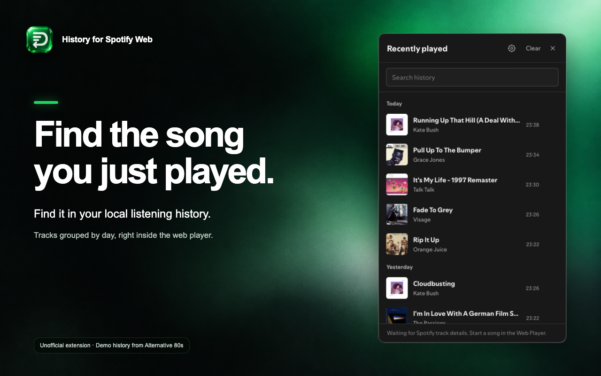

# History for Spotify Web

[English](README.md) · [Português (Brasil)](README.pt-BR.md) · [Español](README.es.md)

Você pulou uma música boa demais. Agora não lembra o nome.

History for Spotify Web adiciona um histórico de músicas com busca ao Spotify Web. Abra pelo relógio ao lado dos controles de reprodução ou pelo ícone da extensão. Nas opções do histórico, escolha **Barra do player**, **Botão flutuante** (só ícone) ou **Barra superior**. As duas telas compartilham o mesmo histórico.

## Instalar

[Disponível na Chrome Web Store](https://chromewebstore.google.com/detail/mankfcbajkkgnahooffhiookcbbicohn).

Instale a extensão e recarregue a aba ou PWA do Spotify. Pode desafixar o ícone da barra do navegador: o botão **Histórico** continua dentro do Spotify. Mantenha uma aba do Spotify aberta para usar a janela da extensão.

A interface segue o idioma do navegador: português do Brasil, espanhol ou inglês. Para outros idiomas, usa o inglês.

## O que ela faz

- Salva a música que você deixou para trás quando o Spotify muda de faixa, inclusive quando você pula uma música.
- Permite buscar por título ou artista e guardar 50, 200 ou 500 registros, agrupados por dia.
- Adiciona um menu por música para colocar na fila, copiar o link ou remover do histórico.
- Exporta e importa cópias em JSON, sem duplicar os registros que já existem.
- Adiciona botões Voltar e Avançar. Arraste o cabeçalho do histórico para mover o painel.

## Instalar pelo GitHub

1. [Baixe o código em ZIP](https://github.com/demetriusk/history-for-spotify-web/archive/refs/heads/main.zip) e extraia em uma pasta que você vai manter.
2. Abra `chrome://extensions` ou `vivaldi://extensions` e ative o modo do desenvolvedor.
3. Clique em **Carregar sem compactação** e selecione a pasta `extension`, que contém `manifest.json`.
4. Se usa o script do Tampermonkey, desative-o. Recarregue o Spotify com **Ctrl+R** ou **⌘R** no Mac.
5. Reproduza uma música e passe para outra. Abra o **Histórico** para ver a que acabou de sair.

Mantenha a pasta no lugar: o navegador carrega a extensão dali. Instalações locais não recebem atualizações automáticas da loja. Para atualizar, substitua os arquivos, recarregue a extensão e depois o Spotify. Desative a cópia local antes de instalar a versão da loja.

## O que vale saber

O histórico começa na instalação e observa as mudanças de música enquanto o Spotify Web está aberto. Não recupera sessões anteriores nem músicas ouvidas em outros aplicativos ou navegadores. Funciona no Chrome e em navegadores Chromium compatíveis com extensões, como o Vivaldi; requer Chromium 114 ou posterior.

Ao escolher **Adicionar à fila**, a extensão busca a música exata e usa o menu do Spotify. Reconhece os menus em inglês, espanhol e português do Brasil. Adiciona a música à fila manual e volta à tela anterior. O Spotify decide se essa ação está disponível para sua conta e dispositivo. A extensão não adiciona chamadas de API exclusivas do Premium.

Quando o link exato de uma música não está disponível, você ainda pode buscá-la ou removê-la do histórico, mas não copiar o link nem adicioná-la à fila pelo menu. Mudanças na interface do Spotify podem afetar essas funções.

## Seus dados

O histórico, o limite escolhido e a posição do botão ficam nos dados locais de `open.spotify.com` deste navegador. A extensão não tem servidor, análise de uso nem sincronização. Os scripts da página do Spotify podem acessar esse mesmo armazenamento.

**Limpar** apaga o histórico salvo; **Remover** exclui um registro. Apagar os dados do site do Spotify também apaga o histórico. Desinstalar a extensão pode deixar esses dados no navegador: limpe o histórico antes se quiser apagá-los.

[Privacidade](PRIVACY.md), [instruções de desenvolvimento](README.md#build-and-test) e [suporte](https://github.com/demetriusk/history-for-spotify-web/issues). A política de privacidade e as instruções de desenvolvimento estão em inglês.

Código aberto com licença [MIT](LICENSE). Extensão independente e não oficial, sem vínculo ou endosso do Spotify.
